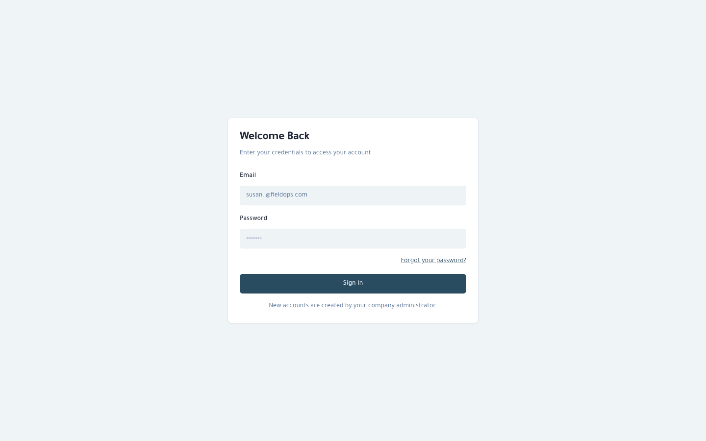
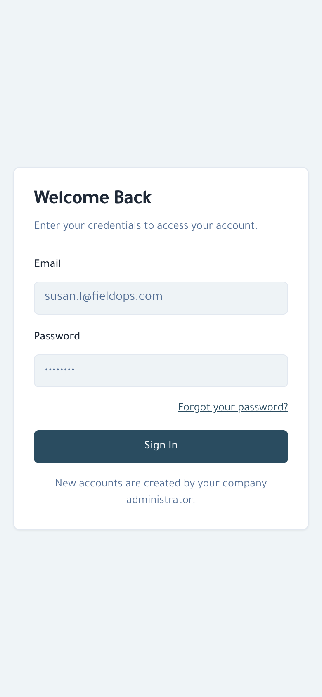

# FieldOps HQ (Hasad)

> Field-service operations: contracts, technician visits and fleet tracking.

**Live:** [hasad.virvib.com](https://hasad.virvib.com/) · **Role:** Developer · **Period:** 2026 · **For:** Client

     

## Overview

A company running maintenance contracts schedules visits automatically, assigns technicians and follows vehicles live on the map.

## What it does

- Contracts with automatic visit scheduling and expiry alerts
- Technician assignment and visit reports
- Live fleet tracking and visit route on an interactive map
- Notifications across the visit and report lifecycle
- Customer and technician accounts

## Engineering highlights

- Fleet-tracking provider integration
- CI/CD and automated server setup

## Screenshots (live site)

  

---

Source code is private (client / commercial project). This repository documents the work only.

Built by **Ahmed Gamal** — Senior Laravel Developer · [LinkedIn](https://www.linkedin.com/in/wzcoder/) · [GitHub](https://github.com/ahmed-gamal-dev)
